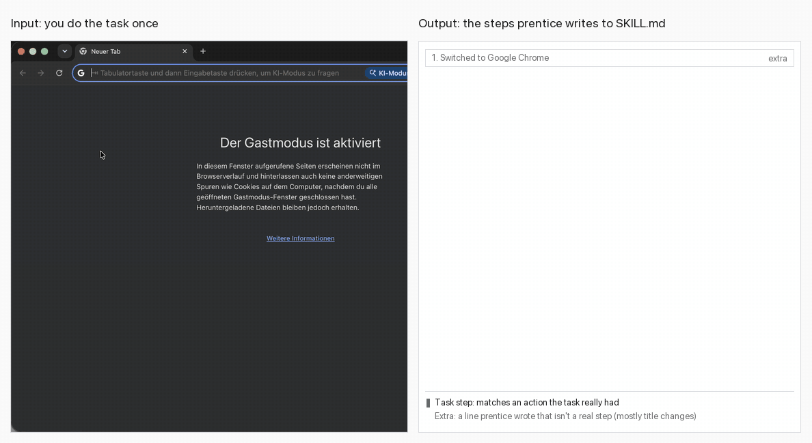
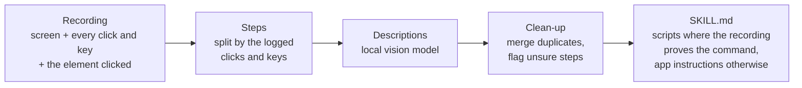

# prentice

[](https://github.com/rocky2397/prentice/actions/workflows/ci.yml)

**Show your Mac a task once; get a skill Claude Code can repeat.**
prentice records you doing something on your computer and turns the recording
into a `SKILL.md`: step-by-step instructions, with ready-to-run scripts where
the recording proves exactly what to run.



A real run, unedited: open Wikipedia, search "Large language model", scroll.
Green lines match the three real actions; grey lines are extra steps prentice
wrote that a person wouldn't count (mostly window-title changes). Both are
shown because cutting that noise is still open work. Full output:
[`docs/example/browser-wikipedia`](docs/example/browser-wikipedia/).

## Why prentice

Claude only knows what was in its training data. New software, new versions
and changed setup screens come later, and often the only up-to-date guide is
someone showing it on video.

The idea behind prentice: instead of watching a tutorial and copying it click
by click, give the recording to prentice and get a skill Claude Code can carry
out for you. The recording can be of you doing the task once, or eventually a
tutorial video you already have.

**Where it stands:** your own recordings work today and are measured (see
[First live test](#first-live-test)), because prentice logs every click and
keystroke while it records. A tutorial video has no such log, so prentice
would have to infer each action from the picture. That path exists but isn't
measured yet, and it's weaker in a second way: a command typed during your own
recording is rebuilt from the logged keystrokes, but from a video alone it
could only come from the model reading the screen, which can misread it. So a
skill made from a tutorial needs a human read before anything in it runs.

## In 30 seconds

1. **Record.** You start and stop it yourself. It saves the screen plus every
   click and keystroke, and for each click, which button or field was hit.
2. **Split into steps,** using those logged clicks and keys: exact, no
   guessing from video.
3. **Describe each step** with a vision model that runs locally on the Mac:
   no API key, nothing leaves the machine.
4. **Clean up:** merge duplicates and flag steps the model wasn't sure about.
5. **Write the skill.** A step becomes a script only when there is an exact
   command or address: best, a command typed into Terminal and run with Enter,
   rebuilt from the logged keystrokes; otherwise one the model read off the
   screen. Everything else becomes an instruction for Claude Code to carry out
   in the app. It never turns a description into a guessed command.



For example, from the live terminal task the event log held these keys
(Enter shown as ⏎; the local path is shortened here):

```text
cd ~/code/prentice⏎   ls⏎   git log --oneline -3⏎
```

and prentice wrote them, character for character, into one script, so the
`cd` carries over to the next commands:

```sh
cd ~/code/prentice
ls
git log --oneline -3
```

The vision model's own reading of that screen had dropped a character from
the path; the script comes from the keystrokes, not from the model.

**Does it work?** Partly, and it's measured: in a first live test it found
10 of the 11 real steps, and the terminal task's script ran on replay. But
about two in three of its steps are still noise, so it's a research prototype,
not a tool to trust yet. Details below.

**Example output:** [the skill prentice wrote for a three-command terminal
task](docs/example/terminal-git/).

macOS only. The full design and its trade-offs are in
[`ARCHITECTURE.md`](ARCHITECTURE.md).

## Status

v1, macOS only. All five stages are implemented: **Stage 1 (Capture)**,
**Stage 2 (Segment)**, **Stage 3 (Interpret)**, **Stage 4 (Refine)**, and
**Stage 5 (Ground & output)** — so the pipeline now runs end to end and
produces a `SKILL.md`.

**First measured results (Nov 2026):** three short live recordings, made by a
script that does the tasks while prentice records. prentice found **10 of the
11 real steps**, captured **5 of 7 concrete values** (commands, names), put
accessibility identifiers on clicks for the first time, and turned the
terminal task into a script that ran successfully on replay. About two in
three of its steps are still noise, and Stage 4 failed to parse its own
model's output on two of the three recordings. Details, and what these
numbers don't measure: [First live test](#first-live-test).

### Next work

Done since the first version of this list: a live capture (scripted, see
below), the step scorer, and fixes it surfaced (terminal commands scripted
from the event log, a stale app name in the window tracker, a crash on one
bad model answer, and a roughly 13x faster Stage 3). In priority order now:

1. **Stage 4's parse failures.** On two of the three live recordings the
   local model's refine output wasn't valid JSON, so every step passed
   through unrefined: no merging, no noise removal. Levers are listed in the
   Stage 4 section (smaller chunks, a stricter output schema, a dedicated
   text model).
2. **Noise steps.** Two in three steps don't match a real step, mostly
   window switches. Some come from the script bringing apps forward, so a
   human recording will show how much of this is real.
3. **Values Stage 3 still misses.** The browser's URL stays in prose, so the
   navigation can't be scripted; on terminal screens the model misreads
   text, which the event log already carries exactly.
4. **A replay harness**, so success on replay is measured rather than
   checked by hand (done once, for the terminal task).
5. **One human recording per task**, to measure how optimistic the scripted
   numbers are.

## Setup

Requires macOS, [Homebrew](https://brew.sh), and
[`uv`](https://docs.astral.sh/uv/):

```sh
brew install ffmpeg uv
uv sync
```

### Model checkpoints

Stage 2's CLIP model and Stage 3's VLM are both downloaded from Hugging Face
on first use. Rather than Hugging Face's own default (the home-directory
cache — easy to forget about, and not necessarily the disk you meant),
`src/prentice/__init__.py` defaults `HF_HOME` to `.model_cache/` inside the
repo, so checkpoints live on the same disk as the project and don't
silently pile up somewhere else. This is only a default: set `HF_HOME`
yourself before running anything if you want a different location.

### Permissions

Capture needs three separate macOS TCC grants, given to whichever terminal
app you run it from (System Settings > Privacy & Security):

- **Screen Recording** — for the video capture itself
- **Accessibility** — for reading the accessibility-tree element under the
  cursor on click, and the focused window title
- **Input Monitoring** — for global mouse/keyboard event logging

Restart the terminal app after granting each. Check your current status
with:

```sh
uv run python scripts/check_permissions.py
```

## Usage

```sh
# list available avfoundation screen-capture devices
uv run prentice-capture devices

# start a session; Ctrl+C to stop (explicit start/stop only, never always-on)
uv run prentice-capture start

# wrap an existing (pre-recorded) video into a session directory instead
uv run prentice-capture import path/to/existing-recording.mov
```

Both commands write a session directory to `eval/recordings/<session_id>/`:

- `screen.<ext>` — the video (fixed-frame-rate `screen.mp4` for a live
  capture; whatever the source file's format is for an import)
- `events.jsonl` — one JSON object per line: mouse clicks/scrolls, key
  presses/releases, window switches — each timestamped as `t_ms` since
  session start, using the same clock anchor as the video's frame clock.
  **Empty for imported sessions** (see below).
- `session.json` — manifest: `source` (`"live_capture"` or `"imported"`),
  `has_events`, fps, video pixel dimensions, and source-specific metadata

### Importing a pre-recorded video

`prentice-capture import` accepts a video from any source (QuickTime, OBS, a
phone, a screen-recording app you already used) and wraps it into a session
directory with the same shape as a live capture — it never touches or moves
the original file, and needs none of the TCC permissions above (it only
shells out to `ffprobe`).

The one thing it *cannot* do is retroactively recover OS-level input events
— those only exist if this tool's listeners were running during the
recording. An imported session's manifest is stamped `has_events: false`
precisely so nothing downstream silently assumes event-quality data exists
for it. Per [`ARCHITECTURE.md`](ARCHITECTURE.md) §2, event logs are what
make segmentation exact; an imported video without one falls back to a
weaker, vision-only signal in Stage 2 (below) — a known, explicitly-flagged
gap, not a hidden one. (Synthesizing an event log for imported video via a
vision model is a separate piece of future work, not part of this import
step.)

**Do not record or import sessions containing secrets** — nothing in this
project redacts sensitive on-screen content.

### Stage 2 — Segment

```sh
uv run prentice-segment eval/recordings/<session_id>
```

Reads a session directory's `session.json` and branches automatically:

- **`has_events: true`** (a live capture) — clusters the logged input events
  into action segments using timestamps and event type: click vs. drag by
  press/release coordinate delta, scroll/type bursts merged within a gap
  threshold, window switches as hard boundaries. No model call — exact.
- **`has_events: false`** (an imported video) — samples frames at a fixed
  rate, embeds them with CLIP (`open_clip`, `ViT-B-32` /
  `laion2b_s34b_b79k`), and flags a boundary wherever cosine similarity
  between consecutive sampled frames drops below a threshold. The starting
  threshold (`0.90`) is a literature-informed guess, **not yet calibrated**
  — `scripts/tune_segment_threshold.py` sweeps thresholds against
  hand-labeled ground truth once that exists in `eval/ground_truth/`.

Both paths write the same output shape to the session directory:

- `segments.jsonl` — ordered segments, each tagged
  `source: "event_log" | "inferred"` and `action_hint` (the concrete action
  type for the event-log path; always `"scene_change"` for the inferred
  path, since vision alone can't say *what* changed, only *that* it did)
- `segment_meta.json` — the parameters that run used, for reproducibility

### Stage 3 — Interpret

```sh
uv run prentice-interpret eval/recordings/<session_id>
```

Reads `segments.jsonl` in order and, for each segment, sends a local VLM
(Qwen3-VL, via [`mlx-vlm`](https://github.com/Blaizzy/mlx-vlm) — runs
entirely on-device on Apple Silicon, no API key or cost) the segment's
before/after keyframes, the raw logged event(s) if any (empty for the
inferred path — the model is told explicitly that no event log exists rather
than being given misleading empty data), and a bounded window of the last 5
interpreted steps as context. Asks for a structured JSON step back: intent,
action type, target description, parameters.

Per [`ARCHITECTURE.md`](ARCHITECTURE.md) §Stage 3, a separate frontier-model
(e.g. Gemini) benchmark to establish a quality ceiling is intentionally out
of scope here — that needs an external API key and costs money per call, so
it's a distinct, separately-scoped piece of work, not bundled into this one.

Writes `steps.jsonl` (each step still carries the originating segment's
`source: "event_log" | "inferred"`, unmodified, same propagation rule as
Stage 2) and `interpret_meta.json` (model/params used). Also writes
`keyframes/<segment_id>/{before,after}.jpg` into the session directory, kept
(not a temp dir) so what the model actually saw for a given step stays
inspectable.

**First run downloads the model checkpoint** (tens of GB, from Hugging Face
— free, but slow and disk-hungry) — the default,
`mlx-community/Qwen3-VL-30B-A3B-Instruct-3bit`, is a MoE with only ~3B active
params/token despite the "30B" name, chosen to stay fast on unified memory.

**Speed and robustness.** Keyframes are scaled to 1280 px wide before the
model sees them (full Retina frames cost about 50 s per segment), a pure
window switch is described from the event log without a model call, a cached
model loads offline (`PRENTICE_UPDATE_MODEL=1` to update), and an answer that
isn't usable JSON becomes a step marked "could not interpret" instead of
stopping the run. On the live recordings a whole run now takes about a
minute. The trade-off: smaller frames make terminal text harder to read.

### Stage 4 — Refine

```sh
uv run prentice-refine eval/recordings/<session_id>
```

Reads `steps.jsonl` and sends it in **bounded chunks of 20 steps** (unlike
Stage 3, which reasons per-segment) to the same already-cached Qwen3-VL,
called text-only — no images, since this stage reasons over Stage 3's
structured output, not pixels. This satisfies `ARCHITECTURE.md` §Stage 4's
"at least a separate call" without a second model download. Per
`ARCHITECTURE.md`, this pass: merges fragmented/duplicate steps, drops
noise, distinguishes fixed vs. variable parameter values, and flags steps it
can't resolve confidently.

Chunking (rather than one call per session) was a deliberate fix, not the
starting design — real testing found a single long generation over a whole
session reliably degrades into malformed JSON, garbled English, or
repetition loops partway through, and this got *more* likely the longer the
session, not just occasionally. Smaller chunks make each individual
generation short enough that this has much less room to happen. It doesn't
eliminate the problem (see below), but it makes the failure mode local to
one chunk instead of catastrophic to the whole session.

Writes `refined_steps.jsonl` + `refine_meta.json`. **Deliberately not 1:1
with `steps.jsonl`** — merging and noise-dropping both change the count.
Each `RefinedStep` keeps `source_step_ids` (traceability to exactly which
Stage 3 steps it absorbed) and a unioned `source`
(`event_log` | `inferred` | `mixed`).

**Reliability guarantees, enforced in code, not just prompt wording** —
every one of these was found necessary by testing against real sessions,
not assumed in advance:
- A merge group larger than 15 input steps is automatically flagged
  `needs_review`, regardless of what the model claims — real testing found
  the model sometimes collapses an entire multi-action stretch into one
  step (up to 123 of 126 steps in one group).
- An input step already claimed by an earlier group can never be claimed
  again by a later one — real testing found the model sometimes appends a
  redundant "catch-all" group re-listing steps already correctly covered
  elsewhere.
- **No step can be silently dropped**, at either the individual-step or
  whole-chunk level. The model can decline to mention a step (intended for
  genuine noise, like an accidental click), but real testing found it doing
  this to genuine distinct actions too (a Save click, a Run click,
  vanishing entirely). Any step the model doesn't account for — including
  every step in a chunk whose response fails to parse outright — is passed
  through unrefined and flagged for review. Never silently lost.

**Known limitation, validated against all 5 real imported sessions**: these
guarantees mean Stage 4 never corrupts or loses data — every session
produces complete output with 100% of raw steps traceable exactly once —
but merge *quality* still varies a lot, and per-chunk parse failures remain
common even at 20-step granularity:

| Session | Raw steps | Refined | Chunks that failed to parse |
|---|---|---|---|
| Chrome (322b4ab2) | 79 | 79 | all 4 — output is 100% passthrough |
| Chrome (88b72c3b) | 126 | 124 | 5 of 7 |
| VS Code (99f1919f) | 63 | 62 | 3 of 4 |
| debugger (eca285c3) | 30 | 30 | both — 100% passthrough |
| Finder (c9bc0323) | 93 | 67 | 0 of 5 — real merging happened |

So chunking fixed the *severity* (no more total session loss, which
happened on 3 of 5 sessions before this fix) but not the *frequency* of
individual chunks producing bad JSON — that's still common. The safety net
means a bad chunk degrades gracefully to "flagged, unrefined" rather than
"lost," which is the property that actually matters, but the refining
value-add is inconsistent session to session. Next levers, not yet
attempted: a smaller chunk size, a stricter/more constrained output schema,
or a different (non-VLM) text-reasoning model for this stage specifically.

### Stage 5 — Ground & output

```sh
uv run prentice-ground eval/recordings/<session_id>
```

Reads `refined_steps.jsonl` and decides, per step, how it should actually be
replayed — then emits the pipeline's real deliverable to
`<session_dir>/skill/`: a `SKILL.md` with YAML frontmatter (name,
description, required inputs), the ordered step list, and a verification
section, plus a `scripts/` subfolder for any generated scripts. Also writes
`grounded_steps.jsonl` + `ground_meta.json`.

Unlike Stages 3 and 4, this stage makes **no model call at all**. Two
reasons: the grounding decision is a rule, not a judgment, and Stage 4's
measured failure rate (5 of 7 chunks on one session) is a poor argument for
putting this model in the path that produces the one artifact meant to be
trusted. A run is therefore reproducible from its inputs alone, which is
also why `ground_meta.json` records no sampling parameters.

**A step becomes a scripted action only when a concrete executable value
appears in its `parameters`** — a `command`, a URL with an explicit scheme
(under any key) or a well-formed hostname under a URL-named key, or an
application name. The prose `target_description` is *never* treated as
evidence. Turning `"the YouTube homepage"` into `open https://youtube.com`
would produce a command that looks exactly as confident as a real one and
runs without ever showing a human what it guessed. A wrong scripted action
is strictly worse than an honest UI-replay step, so the rule refuses to
guess. Everything else becomes a UI-replay action carrying the semantic
target description as the primary handle, the accessibility identifier when
one was captured, and raw coordinates only as an explicitly-labelled
last-resort hint — never as the primary target, per
[`ARCHITECTURE.md`](ARCHITECTURE.md) §Stage 5.

**One source is stronger than `parameters`: the event log itself.** When a
step's keystrokes were typed in a terminal app (the last window switch before
it names one) and every line ends with Enter, the typed text is the command
that ran, character for character, so Stage 5 scripts it and labels the step
`run_command`, whatever the model called it. Anything that makes the text
uncertain (Tab completion, arrow keys, shortcuts, a click or window switch in
between, a line without Enter) leaves the step as UI replay. On the first live
recording (`eval/tasks/terminal-git`) this turned 0 of 3 commands into 3 of 3
scripts, with the exact text; the model's own transcription had dropped the
leading `/` of a path. Consecutive commands like these are then merged into
one script, because each script runs in its own shell and a `cd` must carry
over to the commands after it (`ground/terminal_session.py`). The merged
script from that recording ran successfully: the first generated script to
be replayed.

The accessibility identifier and coordinates don't exist on `Step`, so they
can't be read straight out of `refined_steps.jsonl`. They're recovered by
walking the traceability chain every earlier stage maintained:
`RefinedStep.source_step_ids` → `Step.segment_id` → `Segment.events` →
`MouseClickEvent.ax_element`.

Stage 4's single `needs_review` bool is also split into a finer signal,
because on real sessions it is dominated by one cause that isn't a quality
judgment at all: `unrefined_passthrough` (Stage 4's chunk failed to parse,
or the model omitted the step) versus `model_flagged` (the step *was*
refined and something judged it low-confidence anyway). Collapsing the two
would make the flag useless exactly where it matters.

**Results on the 5 real sessions** — this table mostly measures the quality
of what Stages 3 and 4 hand over, not Stage 5's decision logic:

| Session | Steps | Scripted | UI-replay | With AX id | Flagged |
|---|---|---|---|---|---|
| Chrome (322b4ab2) | 79 | 0 | 79 | 0 | 79 |
| Chrome (88b72c3b) | 124 | 0 | 124 | 0 | 119 |
| VS Code (99f1919f) | 62 | 0 | 62 | 0 | 60 |
| debugger (eca285c3) | 30 | 0 | 30 | 0 | 30 |
| Finder (c9bc0323) | 67 | 1 | 66 | 0 | 45 |
| **Total** | **362** | **1** | **361** | **0** | **333** |

One step out of 362 was scriptable: a `{"application": "Terminal.app"}`
parameter becoming `open -a Terminal.app`. Every `navigate` step that
plainly *was* a navigation — to YouTube, to Gmail, to a Reddit link — came
out of Stage 3 with empty `parameters`, so no URL exists to script, and the
rule above correctly declines to invent one. Zero steps carry an
accessibility identifier because no imported session has an event log. The
"prefer scripts" path that `ARCHITECTURE.md` calls the biggest reliability
lever is therefore built and tested but essentially unexercised by this
data — the lever it depends on is upstream parameter extraction, which is
where the effort belongs next, not in loosening this rule.

## Development

GitHub Actions runs lint and the test suite on macOS for every push to
`main` and every pull request (`.github/workflows/ci.yml`, Python 3.12 and
3.14). Pushing a version tag that matches `pyproject.toml` (e.g. `v0.2.0`)
tests again, builds the wheel and source archive, and publishes them as a
GitHub Release (`release.yml`). Locally:

```sh
uv sync --extra dev
uv run pytest
```

The CLIP-path and VLM-path integration tests each download a real checkpoint
(~600MB and tens of GB respectively) and run real inference, so both are
opt-in rather than part of the default run:

```sh
PRENTICE_TEST_CLIP=1 uv run pytest tests/test_clip_boundary_detection.py
PRENTICE_TEST_VLM=1 uv run pytest tests/test_interpret_vlm.py tests/test_refine_llm.py
```

Stage 5's tests need neither a checkpoint nor ffmpeg — grounding reads only
the earlier stages' JSON output, so a session directory can be faked from
files alone — and run as part of the default suite.

## Eval

See [`eval/README.md`](eval/README.md) for the layout and how to run it.

### First live test

**Setup.** Three short tasks (`eval/tasks/`): three commands in Terminal,
a Wikipedia search in Chrome, and making, filling and renaming a folder in
Finder. `prentice-scripted-run` did each task with real (synthetic) mouse and
keyboard input while prentice recorded live, and wrote down exactly which
steps it performed. That list is the answer key, so nobody labels anything
by hand. `prentice-score` then pairs prentice's steps with the answer key, in
order, by keywords, with no model involved.

**Results** (`eval/results/live/`):

| Task | Real steps found | prentice steps that match a real step | Right kind of action | Values captured | Clicks with an accessibility id |
|---|---|---|---|---|---|
| Terminal | 2 of 3 | 2 of 6 | 2 of 2 | 2 of 3 | – (no clicks) |
| Browser | 3 of 3 | 3 of 8 | 3 of 3 | 1 of 2 | – (no clicks) |
| Finder | 5 of 5 | 5 of 15 | 3 of 5 | 2 of 2 | 4 |
| **All** | **10 of 11** | **10 of 29** | **8 of 10** | **5 of 7** | **4** |

How to read it:

- **Real steps found:** of the steps the task really had, how many prentice
  has a step for. 10 of 11: it rarely misses an action.
- **Steps that match a real step:** the other way round. 10 of 29 means about
  two in three of prentice's steps are noise, mostly window switches; on two
  recordings Stage 4 failed and so removed nothing.
- **Values captured:** whether the step carries the concrete value a script
  would need (the command, the folder name, the search text).
- **The one miss:** on the Terminal recording the model described
  `git log --oneline -3` as something else. The generated script still has
  the exact command, because Stage 5 builds terminal commands from the logged
  keystrokes, not from the model's text.
- **Replay:** the Terminal task's script (`cd`, `ls`, `git log`) ran
  successfully from another folder. That's the only replay so far, checked
  by hand.

**What these numbers don't measure:**

- **A person.** A script acts cleanly: no hesitation, no corrections, no
  wandering mouse. Human recordings will score lower.
- **Much.** Three short tasks, one run each: a first data point, not a
  benchmark.
- **The matcher is a proxy.** Keywords stand in for "this is the same step"
  and can be fooled; a step Stage 4 merges counts as one found and one
  missed.

**Before these fixes**, the same tasks scored 3 of 3 (Terminal) and 3 of 3
(Browser) found, and the Finder run crashed on one malformed model answer
(`eval/results/baseline/`). Terminal's drop from 3 to 2 comes from the
smaller keyframes (the speed-up): the model read the terminal text less
well. Keeping full-size frames for terminal windows would likely win it
back. The recordings behind that baseline also logged
the wrong app on every window switch, so they were recorded again.
